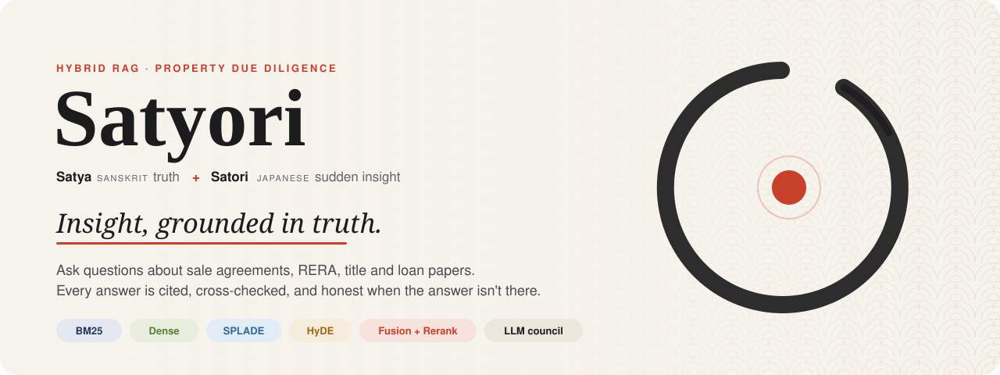
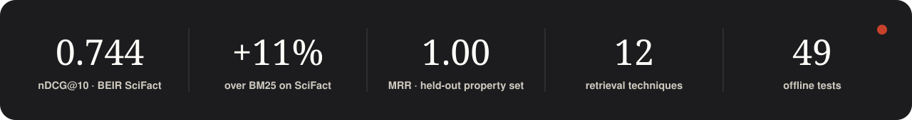
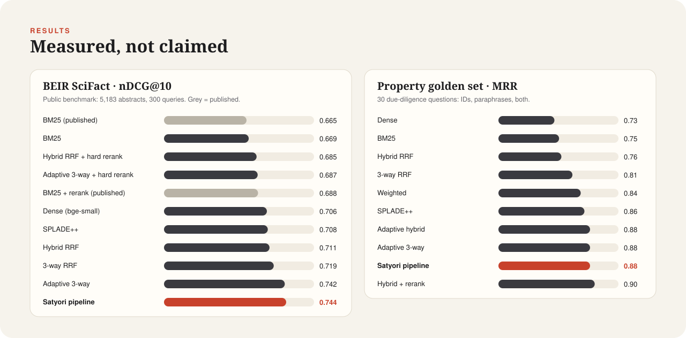
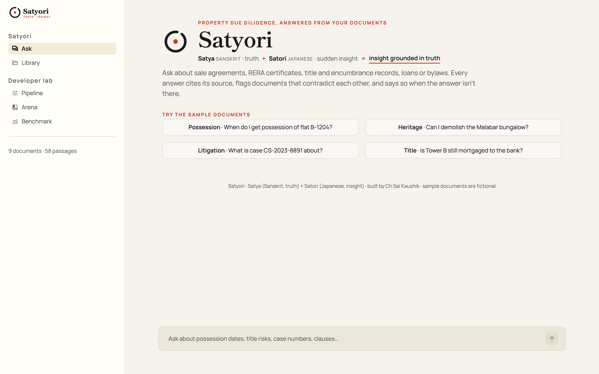
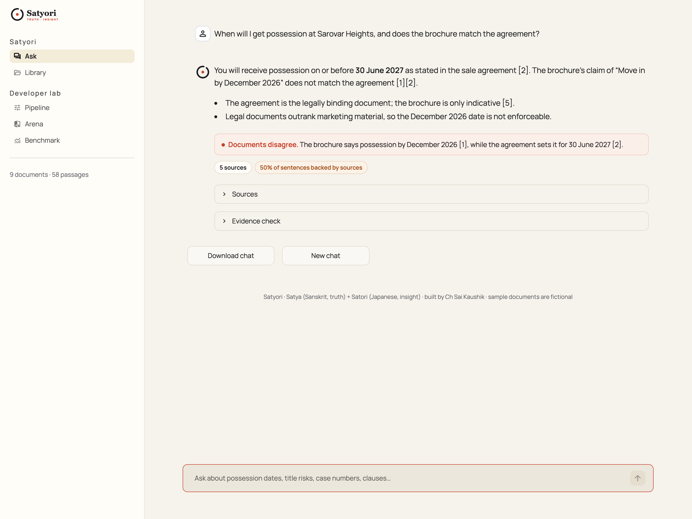
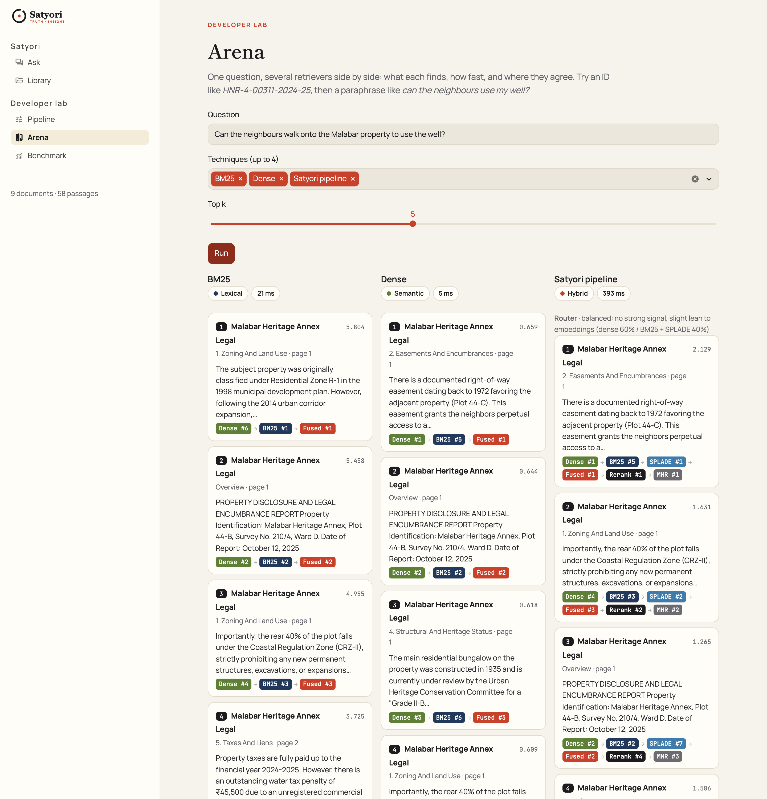
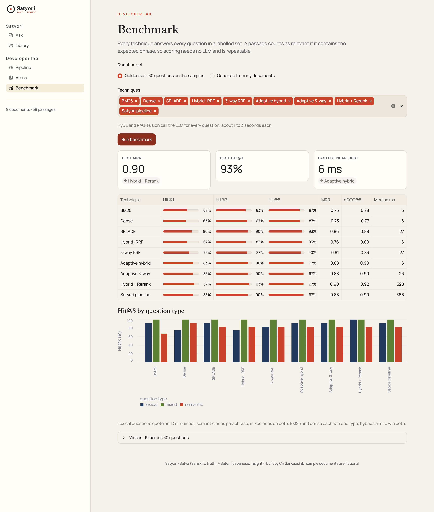
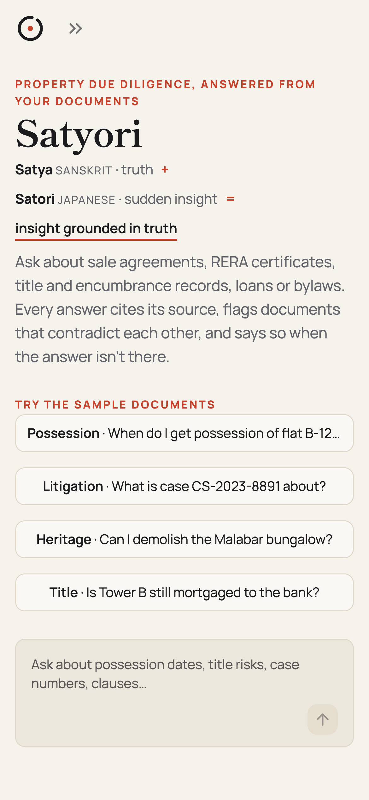
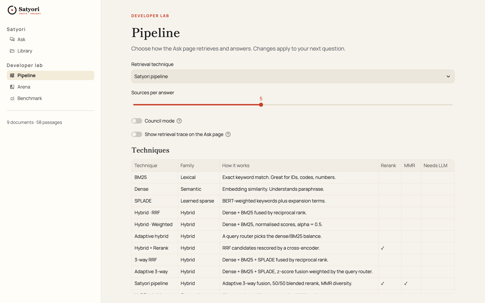
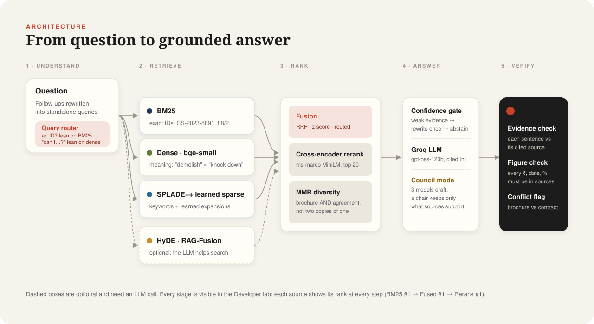

<div align="center">



<br/>

**Satyori** is a hybrid RAG assistant for Indian property due diligence, and a lab for testing retrieval techniques against each other.<br/>
Ask about a sale agreement, RERA certificate, title search or loan letter: it answers with citations, flags documents that contradict each other, and says so when the answer isn't there.

<br/>


[](https://github.com/Kaushik-verse/satyori-hybrid-rag/actions/workflows/ci.yml)

[](https://github.com/Kaushik-verse/satyori-hybrid-rag/stargazers)


[The name](#-the-name) · [Results](#-results) · [What it does](#-what-it-does) · [Architecture](#-architecture) · [Techniques](#-twelve-retrieval-techniques) · [Run it](#-run-it-locally) · [Benchmarks](#-reproduce-the-benchmarks)

</div>

<br/>



## ✦ The name

| | Word | Language | Meaning |
|:-:|---|---|---|
| ⭕ | **Satya** | Sanskrit | truth, what is real |
| 🔴 | **Satori** | Japanese | sudden insight, seeing clearly |
| | **Satyori** | | *insight grounded in truth*: an answer is only worth giving if the documents back it |

The mark is an **ensō**, the Zen brush circle, around a **bindu**, the point of origin in Indian thought: the answer at the centre, the evidence all around it.

## ✦ Results



**On a public benchmark.** [BEIR SciFact](https://github.com/beir-cellar/beir) is 5,183 scientific abstracts and 300 expert questions, nothing like the property documents Satyori was built for, which makes it a fair test. Satyori's own BM25 scores 0.669, matching the published 0.665, so the harness is sound.

| SciFact (300 queries) | nDCG@10 | MRR@10 | Recall@100 |
|---|:-:|:-:|:-:|
| BM25 *(published, BEIR paper)* | 0.665 | | |
| BM25 + cross-encoder rerank *(published)* | 0.688 | | |
| BM25 | 0.669 | 0.636 | 0.896 |
| Dense · bge-small | 0.706 | 0.673 | 0.943 |
| SPLADE++ | 0.708 | 0.682 | 0.917 |
| Hybrid RRF · dense + BM25 | 0.711 | 0.679 | **0.968** |
| Adaptive 3-way z-fusion | 0.742 | 0.709 | 0.961 |
| Adaptive 3-way + hard rerank | 0.687 | 0.655 | 0.961 |
| **Satyori pipeline** · adaptive 3-way + 50/50 blended rerank | **0.744** | **0.714** | 0.961 |

<sub>The SciFact row measures retrieval through the blended rerank. In the app, MMR then reorders positions 2 to 5 for diversity; it never moves the top passage.</sub>

**On property documents.** Two question sets over the nine sample documents. The held-out set was written *before* any tuning and never used to choose settings.

| Technique | Golden · Hit@1 | Golden · MRR | Held-out · Hit@1 | Held-out · MRR | Latency |
|---|:-:|:-:|:-:|:-:|:-:|
| BM25 | 0.67 | 0.75 | 0.71 | 0.84 | 5 ms |
| Dense | 0.63 | 0.73 | 0.79 | 0.83 | 5 ms |
| SPLADE++ | 0.80 | 0.86 | 0.96 | 0.98 | 30 ms |
| Adaptive 3-way | 0.83 | 0.88 | **1.00** | **1.00** | 28 ms |
| Hybrid + hard rerank | **0.87** | **0.90** | **1.00** | **1.00** | 337 ms |
| **Satyori pipeline** | 0.83 | 0.88 | **1.00** | **1.00** | 362 ms |

### What the numbers taught

1. **Every hybrid beats every single retriever.** Exact IDs and paraphrased questions need different tools; combining them is worth +11% nDCG on SciFact and +17% MRR on the property set.
2. **SPLADE is the strongest single channel**, a learned sparse model that is exact *and* expands vocabulary. Adding it as a third channel lifted SciFact from 0.711 to 0.742.
3. **How you fuse matters more than what you fuse.** Rank fusion (RRF) of three channels scored 0.719; score fusion that standardises each channel and lets a query router weight them scored 0.742, with the same inputs.
4. **A reranker is not free accuracy.** The ms-marco cross-encoder helps on property questions but *drops* SciFact from 0.742 to 0.687: it was trained on web search, not science. Blending its score 50/50 with the hybrid keeps the in-domain gain and loses nothing out of domain. The hard rerank still wins the golden set by one question; the blend is the safer default.
5. **One config bug was worth +4%.** fastembed does not prepend BGE's query instruction; adding it lifted dense nDCG on the property set from 0.756 to 0.787.

## ✦ What it does

| | Feature | Why it matters |
|:-:|---|---|
| 🔀 | **Twelve retrieval techniques**, from BM25 to a 3-way adaptive hybrid with reranking | Property papers mix exact IDs (`CS-2023-8891`, `Survey No. 88/2`) with plain-language questions ("can I knock it down?"). No single retriever handles both. |
| 🧭 | **Query router** | Picks the dense/sparse balance per question: an ID leans on keywords, an open question leans on meaning. |
| ⚖️ | **Conflict radar** | The brochure says *December 2026*, the agreement says *30 June 2027*. Satyori shows both and says which document wins. |
| 🛑 | **Knows when it doesn't know** | Weak evidence triggers one query rewrite, then an honest "not in your documents" instead of a guess. |
| 🔍 | **Evidence check** | Every sentence is compared with the source it cites, and every ₹ amount, date and percentage must appear in that source. |
| 🏛️ | **Council mode** | Three models draft in parallel; a chair model keeps only what the sources support (the multi-LLM pattern from the reference design). |
| 🧪 | **Developer lab** | An Arena to compare retrievers side by side, a Benchmark with Hit@k / MRR / nDCG, and a trace of every source's rank at each stage. |

## ✦ Screenshots

<table>
  <tr>
    <td width="50%"><br/><sub><b>Ask:</b> the name and what it means, front and centre</sub></td>
    <td width="50%"><br/><sub><b>Conflict radar:</b> brochure says Dec 2026, agreement says 30 June 2027</sub></td>
  </tr>
  <tr>
    <td width="50%"><br/><sub><b>Arena:</b> BM25 misses the paraphrase; each source shows its rank at every stage</sub></td>
    <td width="50%"><br/><sub><b>Benchmark:</b> every technique scored on the same questions</sub></td>
  </tr>
</table>

<details>
<summary><b>📱 Mobile</b> and <b>⚙️ Pipeline settings</b></summary>
<br/>
<p align="center">&nbsp;&nbsp;</p>
</details>

## ✦ Architecture



<details>
<summary><b>🗂️ Project structure</b></summary>

```
app.py                    Streamlit shell: navigation and branding
views/                    Pages: Ask and Library (users), Pipeline, Arena, Benchmark (developers)
satyori/
├── ingest.py             PDF / text / URL loading, section-aware chunks with contextual headers
├── index.py              BM25, dense embeddings, SPLADE learned sparse, per-session library
├── retrieval.py          Twelve techniques: fusion, query router, cross-encoder rerank, MMR, HyDE, RAG-Fusion
├── answer.py             Cited answers, confidence gate, council mode, evidence and figure checks
├── evaluate.py           Hit@k, MRR, nDCG; question generation from your own documents
├── llm.py                Thin Groq wrapper
└── config.py             Settings from the environment
bench/                    Reproducible benchmarks: BEIR SciFact and the property question sets
data/corpus/              Nine fictional property documents (two PDFs, seven Markdown)
data/eval/                Golden set (30 questions) and held-out set (24, never used for tuning)
tests/                    49 offline tests: no network, no API key
```
</details>

## ✦ Twelve retrieval techniques

| Family | Technique | How it works |
|---|---|---|
| Lexical | **BM25** | Okapi BM25 with an ID-aware tokenizer (`88/2`, `CS-2023-8891` stay whole and are also split) |
| Learned sparse | **SPLADE++** | A BERT model writes weighted keywords *and* related terms the text never used |
| Semantic | **Dense** | `bge-small-en-v1.5` embeddings, with the query instruction the model was trained on |
| Hybrid | **RRF** · **Weighted** · **Adaptive** | Dense + BM25 fused by rank, by normalised score, or by a per-query router |
| Hybrid | **3-way RRF** · **Adaptive 3-way** | Adds SPLADE as a third channel; z-score fusion weights each channel by how confident it is |
| Hybrid | **Hybrid + Rerank** | A cross-encoder rereads the top 20 candidates together with the question, and its order replaces the fusion order |
| Hybrid | **Satyori pipeline** *(default)* | Adaptive 3-way fusion → cross-encoder rerank of the top 20, blended 50/50 with the fusion score → MMR diversity that never moves the top passage |
| Generative | **HyDE** · **RAG-Fusion** | The LLM imagines an answer to search with, or rewrites the question three ways |

<details>
<summary><b>🔧 Bugs fixed from the original project</b></summary>

The project started as a single-file real-estate RAG demo. The audit found:

| Problem | Effect | Fix |
|---|---|---|
| Default model `llama-3.3-70b-versatile` and fallback `mixtral-8x7b` are no longer served by Groq | Every question failed | `openai/gpt-oss-120b`, configurable |
| `import pysqlite3` and `st.secrets[...]` at import time | Crashed on macOS and any machine without a secrets file | Optional secrets, no sqlite shim |
| Price metadata hard-coded with `if "Whitefield" in filename` | Price filters only worked for one sample file | Removed; retrieval is document-agnostic |
| Chroma persisted to disk, BM25 kept in memory | After a restart, hybrid search silently became dense-only | One in-memory index per session, rebuilt together |
| Module-level globals | All users shared one library; "clear" wiped everyone's documents | Library stored per browser session |
| "Reranker" reused the retrieval embedding | Reranking undid the BM25 contribution | Real cross-encoder |
| BM25 returned zero-score documents | Irrelevant chunks entered fusion | Only chunks sharing a term are ranked |
| fastembed does not add BGE's query instruction | Dense retrieval lost accuracy (nDCG@10 0.756 → 0.787 once fixed) | Model-specific query prefixes |
| No chat memory, report rendered one turn late, temp files leaked when a PDF failed to parse | Follow-ups failed, downloads were stale | Follow-up condensing, fixed render order, files read in memory |
| Uploading the same PDF twice | Duplicate chunks crowded out other results | Files are fingerprinted and indexed once |

The original ROI calculator was removed to keep the project focused on retrieval; its maths also returned a negative mortgage when the down payment exceeded the price.
</details>

## ✦ Run it locally

> Running the code is permitted only for evaluating the author's work. See [License](#-license).

Requires Python 3.11+ and [uv](https://docs.astral.sh/uv/). A free [Groq API key](https://console.groq.com/keys) enables answers; without one, Satyori runs retrieval-only and the Developer lab works fully.

```bash
git clone https://github.com/Kaushik-verse/satyori-hybrid-rag.git
cd satyori-hybrid-rag
cp .env.example .env          # add GROQ_API_KEY
uv sync
uv run streamlit run app.py
```

The first start downloads three small ONNX models (about 0.7 GB in total) and caches them. Set `SATYORI_SPLADE_MODEL=` to skip SPLADE on low-memory machines.

### Try these

| Question | What it shows |
|---|---|
| When do I get possession of flat B-1204? | Brochure and agreement disagree; the conflict is flagged |
| What is case CS-2023-8891 about? | The router leans on exact matching for an ID |
| Can the neighbours walk onto the Malabar property to use the well? | Paraphrase: "well" → "shared borewell", "walk onto" → "right-of-way easement" |
| Who won the cricket final? | Abstains instead of guessing |

## ✦ Reproduce the benchmarks

```bash
uv run python bench/scifact.py     # BEIR SciFact: 5,183 abstracts, 300 queries (~3 h on an 8 GB laptop CPU; resumable)
uv run python bench/property.py    # golden + held-out property sets (~1 min)
uv run pytest                      # 49 offline tests
```

## ✦ License

**Copyright © 2026 Ch Sai Kaushik. All rights reserved.**
This repository is public for portfolio viewing only. No permission is granted to copy, use, modify or
distribute any part of it without written consent; see [LICENSE](LICENSE). Hiring teams may run it
locally to evaluate the work. Sample documents are fictional. SciFact is © its authors (CC BY-NC 2.0) and is downloaded at run time, not redistributed.

<div align="center">
<br/>
If Satyori taught you something about hybrid retrieval, a ⭐ helps more people find it.
<br/><br/>
<sub>Built by <b>Ch Sai Kaushik</b> · B.Tech CSE (Data Science), VIT Vellore · <a href="https://github.com/Kaushik-verse">@Kaushik-verse</a></sub>
</div>
